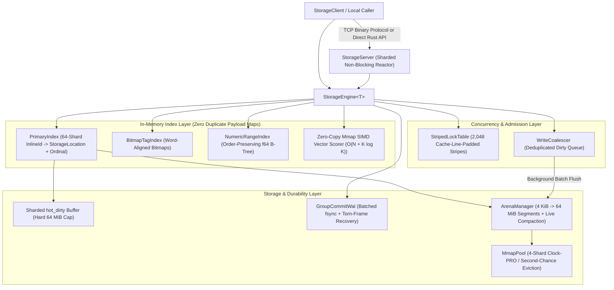

# Storine

[](LICENSE)
[](Cargo.toml)
[](Cargo.toml)

**Storine** is an ultra-fast, zero-copy, memory-mapped embedded storage engine and sharded non-blocking TCP server written in pure Rust with **zero third-party runtime dependencies**.

It is engineered for workloads requiring **sub-microsecond reads (`187 ns` p50)**, **zero heap allocations on hot read paths**, **coalesced microsecond writes (`4.6 µs` p50)**, **hybrid secondary + SIMD vector search**, **bidirectional relational links (`1:1`, `1:N`, `M:N`)**, and **million-connection scalability (`~88 bytes` per idle TCP connection)**.

---

## Key Features

- **Zero-Copy Memory-Mapped Reads (`0.00 Allocs/Op`)**:
  - 64-byte cache-line-aligned record frames (`[RecordHeader (64B) | Relative-Offset Archive Payload]`) are memory-mapped directly from disk into virtual address space and dereferenced in-place (`187 ns` p50 via `StorageEngine::with_ref`, `3.12M ops/sec`) without deserializing or allocating heap memory.
- **Dual-Tier Storage & Write Coalescing**:
  - Hot updates land immediately in a 64-way sharded in-RAM write buffer (`hot_dirty`, capped by `max_hot_dirty_bytes`) and are coalesced in the background into 4 KiB-growable, 64-byte-aligned arena segment files (`seg_XXXXX.dat`), eliminating up to **71.6% of redundant physical disk writes**.
- **Group-Commit Write-Ahead Log (WAL) & Torn-Frame Recovery**:
  - Supports both `SyncMode::Coalesced` (memory-first with background disk sync) and `SyncMode::Durable` (group-committed WAL batching concurrent writers into a single `fsync`). Automatically detects and truncates torn trailing frames after unexpected power loss.
- **End-to-End Hardware Checksum Verification**:
  - Every 64-byte `RecordHeader` and payload is protected by 4-way unrolled `XXH3-64` combined with hardware SSE4.2 `CRC32C` (`_mm_crc32_u64` at `~1.84 GB/s`), catching single-bit flips on both disk and network paths.
- **Hybrid Indexing & $O(N + K \log K)$ SIMD Vector Search**:
  - **Primary Index**: 64-shard cache-line-padded hash index keyed by 24-byte stack-allocated `InlineId`s (`3 ns` hash + equality), persisted in a compact varint checkpoint (`primary.idx` at `19.0 bytes/record`).
  - **Tag Index**: Word-aligned `CompactBitmap` inverted index driving multi-tag `AND`/`OR` intersections from the smallest posting list via hardware `TZCNT`.
  - **Numeric Range Index**: IEEE-754 order-preserving `BTreeMap` index supporting fast `[min, max]` range scans.
  - **Vector Similarity Search**: 8-way unrolled SIMD cosine similarity (`87 ns` per 64-dim vector) paired with Hoare/Floyd-Rivest Quickselect (`select_nth_unstable_by`) for linear $O(N)$ top-$K$ partitioning.
- **Deadlock-Free Bidirectional Relational Graph (`1:1`, `1:N`, `M:N`)**:
  - First-class `OneToOne`, `OneToMany`, and `ManyToMany` containers with canonical lock ordering (`StripedLockTable::lock_many`) that mathematically prevents AB-BA deadlocks during concurrent bidirectional link updates.
- **Sharded Non-Blocking TCP Server (`StorageServer`)**:
  - Fixed pool of `ReactorShard` worker threads multiplexing non-blocking sockets (`NonBlockingConn`, `~88 bytes` per idle connection) with zero-allocation vectored `IoSlice` socket writes and dynamic `max_connections` admission control.

---

## Architecture Overview



---

## Workspace Crates

| Crate | Path | Description |
| :--- | :--- | :--- |
| **`storage-types`** | [`crates/storage-types`](crates/storage-types) | Core primitives: 24-byte `InlineId`, 64-byte `RecordHeader`, `RecordOrdinal`, `Version`, `CachePadded<T>`, and unified `StorageError`. |
| **`storage-codec`** | [`crates/storage-codec`](crates/storage-codec) | Zero-copy relative-offset archive format (`RelPtr<T>`, `RelStr`, `RelSlice<T>`), `AlignedBytes`, LZ4-style compression, and SIMD `XXH3-64 + CRC32C` checksums. |
| **`storage-mmap`** | [`crates/storage-mmap`](crates/storage-mmap) | Cross-platform OS memory mapping (Win32 `CreateFileMappingW` / POSIX `mmap`), 4-shard Clock-PRO `MmapPool`, and `ArenaManager` with live compaction. |
| **`storage-wal`** | [`crates/storage-wal`](crates/storage-wal) | `GroupCommitWal` batching concurrent durable writes with automatic torn-frame truncation and crash replay. |
| **`storage-index`** | [`crates/storage-index`](crates/storage-index) | 64-shard `PrimaryIndex`, compact `STGEIDX2` checkpointing, `BitmapTagIndex`, `NumericRangeIndex`, and SIMD cosine similarity kernel. |
| **`storage-graph`** | [`crates/storage-graph`](crates/storage-graph) | Bidirectional `OneToOne`, `OneToMany`, and `ManyToMany` relational containers and referential integrity verifiers. |
| **`storage-core`** | [`crates/storage-core`](crates/storage-core) | Unified `StorageEngine<T>`, `RecordRef<T>`, `WriteCoalescer`, `StripedLockTable`, hybrid query planner, and chaos crash-recovery tests. |
| **`storage-server`** | [`crates/storage-server`](crates/storage-server) | Sharded non-blocking TCP event reactor (`StorageServer<T>`) and binary client (`StorageClient`) with runtime `max_connections` admission control. |
| **`storage-cli`** | [`crates/storage-cli`](crates/storage-cli) | Command-line inspection, CRUD, hybrid search, compaction, and diagnostics utility. |
| **`benches`** | [`benches`](benches) | Release benchmark harness with custom `TrackingAllocator` enforcing `0.00` heap allocations on hot read paths. |

---

## Quick Start

### 1. Embedded Engine Usage (Rust)

```rust
use storage_core::{AgentObjectRecord, EngineConfig, QueryPlan, StorageEngine};
use storage_types::InlineId;

fn main() -> storage_types::Result<()> {
    let engine = StorageEngine::<AgentObjectRecord>::open("./data", EngineConfig::default())?;

    let id = InlineId::from_static("agent:atlas-01");
    let mut record = AgentObjectRecord::new(id, "Atlas Memory Node", 1_700_000_000, 950);
    record.tags = vec!["ai".into(), "memory".into()];
    record.embedding = vec![0.25; 64];

    // 1. Insert or update in memory (coalesced to disk in background)
    let version = engine.put(id, &record)?;
    assert_eq!(version.0, 1);

    // 2. Zero-allocation hot read directly from mmap / in-memory frame (187 ns p50)
    engine.with_ref(id, |view| {
        println!("Title: {}, Score: {}", view.get_str(&view.title), view.score);
    })?;

    // 3. Hybrid query: Tag filter + Numeric range + Top-K SIMD vector similarity
    let hits = engine.search_hybrid(&QueryPlan {
        required_tags: vec!["ai".into()],
        any_tags: vec![],
        numeric_ranges: vec![("score".into(), 900.0, 1000.0)],
        query_embedding: Some(vec![0.25; 64]),
        top_k: 10,
    })?;
    println!("Matched {} records (top hit: {})", hits.len(), hits[0].id);

    Ok(())
}
```

### 2. Network Server & Client Usage

```rust
use std::sync::Arc;
use storage_core::{AgentObjectRecord, EngineConfig, StorageEngine};
use storage_server::{ decode_agent_frame, StorageClient, StorageServer };
use storage_types::InlineId;

fn main() -> storage_types::Result<()> {
    let engine = Arc::new(StorageEngine::<AgentObjectRecord>::open(
        "./server_data",
        EngineConfig::default(),
    )?);

    // Start non-blocking sharded TCP server with custom max_connections limit
    let mut server = StorageServer::start_with_max_connections(
        "127.0.0.1:7878",
        Arc::clone(&engine),
        250_000,
    )?;

    // Dynamically adjust connection limit at runtime without restarting
    server.set_max_connections(500_000);

    // Connect client and stream zero-copy 64B-aligned record frames
    let mut client = StorageClient::connect(server.local_addr())?;
    let id = InlineId::from_static("net:item-01");
    let rec = AgentObjectRecord::new(id, "Zero-Copy Network Record", 1_700_000_000, 42);

    client.put(id, &rec)?;
    let frame = client.get_frame(id)?;
    let view = decode_agent_frame(&frame)?;
    assert_eq!(view.get_str(&view.title), "Zero-Copy Network Record");

    server.stop();
    Ok(())
}
```

---

## CLI & Standalone Server

### Build All Binaries
```bash
cargo build --release
```

### Run the TCP Server
```bash
# Default (./server_data on 127.0.0.1:7878, max_connections = 100,000)
cargo run --release -p storage-server

# Custom data directory, bind address, and max simultaneous connections
cargo run --release -p storage-server -- ./server_data 0.0.0.0:7878 --max-connections 500000
```
You can also set the connection ceiling via the `STORAGE_MAX_CONNECTIONS` environment variable.

### Run the CLI Utility
```bash
cargo run --release -p storage-cli -- ./data put agent_01 "Primary Node" 100 "ai,core"
cargo run --release -p storage-cli -- ./data get agent_01
cargo run --release -p storage-cli -- ./data stats
cargo run --release -p storage-cli -- ./data compact
```

---

## Verified Benchmarks & Footprint

Measured with `cargo run --release -p benches` (`opt-level = 3`, `lto = "fat"`, `codegen-units = 1`, `-C target-cpu=native`) with hardware allocation tracking enabled:

| Workload | Throughput (`ops/sec`) | `p50` Latency | `p99` Latency | Heap Allocs / Op |
| :--- | ---: | ---: | ---: | ---: |
| **`InlineId` (24B) Hash + Eq** | `309,306,931 / s` | `3 ns` | `9 ns` | **`0.00`** |
| **Zero-Copy `RecordView` Read (`decode_unchecked`)** | `315,300,767 / s` | `3 ns` | `6 ns` | **`0.00`** |
| **SIMD Cosine Similarity (`64-dim f32`, 8-way unrolled)** | `11,572,960 / s` | `87 ns` | `106 ns` | **`0.00`** |
| **`StorageEngine::with_ref` (0-Alloc Hot Read)** | **`3,126,316 / s`** | **`187 ns`** | `2,600 ns` | **`0.00`** |
| **`StorageEngine::get_ref` (Mmap Arena Segment)** | **`1,978,552 / s`** | **`400 ns`** | `4,500 ns` | **`0.00`** |
| **SIMD Checksum (`XXH3-64 + SSE4.2 CRC32C`, 4 KB)** | `448,492 / s` (`~1.84 GB/s`) | `1,900 ns` | `2,500 ns` | **`0.00`** |
| **`StorageEngine::update` (Coalesced Hot Write)** | **`186,555 / s`** | **`4,600 ns`** (`4.6 µs`) | `12,800 ns` | `5.00` |
| **Secondary Index (`Tag Bitmap + B+Tree Range`)** | **`92,866 / s`** | **`5,900 ns`** (`5.9 µs`) | `38,500 ns` | `1.00` |
| **`StorageServer` TCP Binary `GET` Frame RPC** | **`22,260 / s`** | **`34,000 ns`** (`34.0 µs`) | `308,400 ns` | **`0.00`** *(server)* |

### Memory & Disk Efficiency Highlights
- **Per-Connection Server Footprint**: `~88 bytes` per idle `NonBlockingConn` (`~88 MB` for 1,000,000 idle connections vs `~2.1 TB` for thread-per-connection servers).
- **Primary Index Checkpoint (`primary.idx`)**: `19.0 bytes / record` (`4.63x` smaller via varint + compact `InlineId` encoding).
- **Zero Duplicate In-RAM Index/Vector Maps**: Secondary index snapshots and float embeddings are read zero-copy directly from the memory-mapped `&T::Archived` frame (`0 bytes/record` of duplicate heap maps).
- **Compact Release Binaries**: `storage-server` compiles to a self-contained **`370.5 KiB`** binary.

See [`docs/BENCHMARK_REPORT.md`](docs/BENCHMARK_REPORT.md) for the complete latency and footprint verification report.

---

## Contributing

Contributions are welcome! Please read [`CONTRIBUTING.md`](CONTRIBUTING.md) for our architecture invariants, safety rules, and testing workflow before submitting a pull request.

---

## License

Dual-licensed under either of:

- **MIT License** ([`LICENSE`](LICENSE) or <https://opensource.org/licenses/MIT>)
- **Apache License, Version 2.0** ([`LICENSE-APACHE`](LICENSE-APACHE) or <https://www.apache.org/licenses/LICENSE-2.0>)

at your option.
