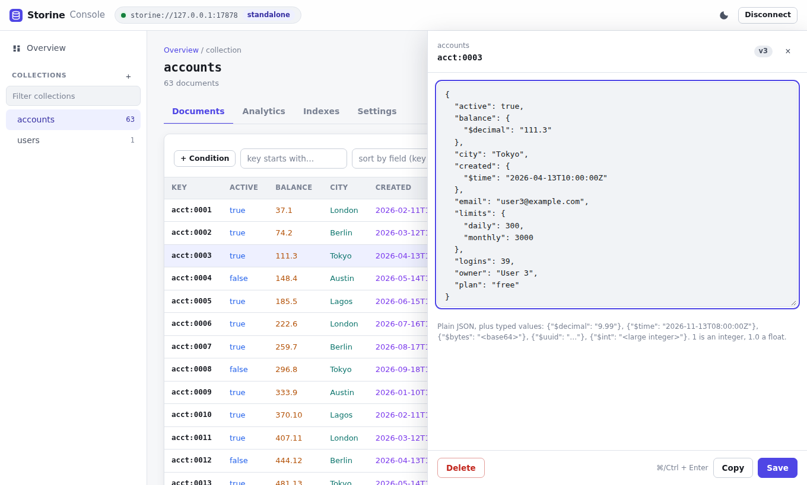
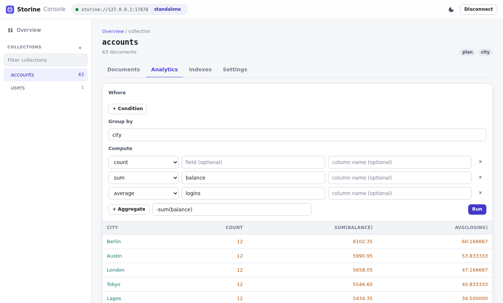
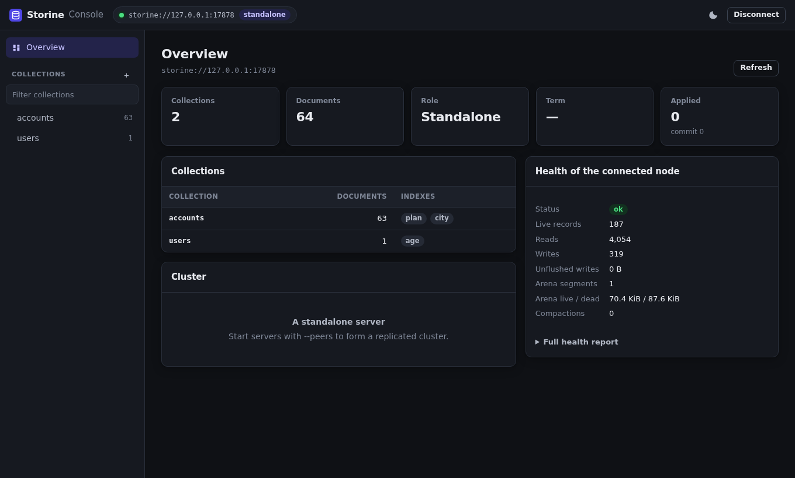

<p align="center">
  
</p>

<h1 align="center">Storine</h1>

<p align="center">
  <strong>A fast document database you can embed, run as a server, or replicate across a cluster.</strong><br>
  Written in Rust, with no third-party dependencies.
</p>

<p align="center">
  <a href="https://github.com/Twilight-Techy/storine/releases/latest"></a>
  <a href="https://github.com/Twilight-Techy/storine/actions/workflows/ci.yml"></a>
  <a href="LICENSE"></a>
  
</p>

<p align="center">
  <a href="#get-started">Get started</a> ·
  <a href="#clients">Clients</a> ·
  <a href="#run-a-cluster">Clusters</a> ·
  <a href="docs/TECHNICAL.md">Technical reference</a> ·
  <a href="CHANGELOG.md">Changelog</a>
</p>

<p align="center">
  
</p>

## Why Storine

- **Fast where it counts.** Reads take about 60 nanoseconds in process and 9 microseconds over the network. Against LMDB and RocksDB at equal durability, Storine leads every throughput row and every p99 row ([benchmarks](docs/BENCHMARK_REPORT.md)).
- **Documents, done properly.** Collections of JSON-like documents with secondary indexes, vector search, exact decimals and server-side aggregates. Changes are atomic: transfer money between two documents and it either all happens or none of it does.
- **One engine, three ways to run it.** Link it into a Rust program, run `storage-server`, or start three servers and get a replicated cluster with automatic failover. Range-partitioned clusters spread data across more nodes, keep transactions across them, and place data by region when you tell them where each node runs.
- **Speaks your stack.** Clients for eight languages, and a SQL gateway that speaks the PostgreSQL, MySQL and SQL Server protocols, so existing apps can switch by changing a connection string.
- **Security built in.** A server refuses to listen beyond localhost until you give it tokens, each with a role. Two settings turn on TLS for clients and between cluster nodes, with certificates the server can issue itself. A key file encrypts everything on disk, logs and backups included, with key rotation. Archived logs let you restore the database as it was at any moment.
- **Small and self-contained.** Each tool is a single file of a few megabytes, with nothing else to install.

| Against LMDB and RocksDB, 1,000,000 keys | Storine | RocksDB | LMDB |
| :--- | ---: | ---: | ---: |
| Random reads, 4 threads | **4.1–4.2 M/s** | 0.96–1.04 M/s | 2.9–3.2 M/s |
| Overwrites, 4 threads | **1.30–1.36 M/s** | 0.54–0.59 M/s | 0.13 M/s |
| Durable writes (fsync), 4 threads | **3,000/s** | 860/s | 470/s |

<sub>AWS `c7i.xlarge`, three rounds each; details and the cases where Storine trails in [section 8.5](docs/BENCHMARK_REPORT.md).</sub>

## Get started

**1. Download** the archive for your system from the [latest release](https://github.com/Twilight-Techy/storine/releases/latest) and unpack it.

| System | Archive |
| :--- | :--- |
| Linux (x86_64, arm64) | `storine-<version>-x86_64-linux.tar.gz`, `storine-<version>-aarch64-linux.tar.gz` |
| macOS (Apple silicon, Intel) | `storine-<version>-aarch64-macos.tar.gz`, `storine-<version>-x86_64-macos.tar.gz` |
| Windows (x86_64) | `storine-<version>-x86_64-windows.zip` |

**2. Start a server:**

```bash
bin/storage-server ./data 127.0.0.1:7878
```

**3. Open the console** in another terminal, and follow the link it prints:

```bash
bin/storine-console storine://127.0.0.1:7878
```

**4. Use it from your code**, here in Python:

```python
from decimal import Decimal
import storine
from storine import add

db = storine.connect("storine://127.0.0.1:7878")
accounts = db.collection("accounts")
accounts.insert("alice", {"owner": "Alice", "balance": Decimal("100.00")})

# Exact and atomic on the server: no lost updates, no overdraft.
accounts.update("alice", add("balance", Decimal("-25.00"), min=0))
```

Prefer building it yourself? `cargo build --release` with Rust 1.82 or newer.

## The console

`storine-console` is a web console for any Storine server or cluster. Browse and edit documents (edits check the version, so you never overwrite someone else's change), filter and sort, run grouped aggregates, manage indexes, and watch the cluster and each node's health. It runs on your machine and only a browser holding the link it prints can use it.

| Analytics | Overview, dark mode |
| :---: | :---: |
|  |  |

## Clients

| Language | Package | |
| :--- | :--- | :--- |
| Python 3.8+ | [`sdks/python`](sdks/python) | `decimal.Decimal` for money |
| TypeScript / Node.js 18+ | [`sdks/typescript`](sdks/typescript) | exact `Decimal` |
| Go 1.21+ | [`sdks/go`](sdks/go) | |
| Java 17+ | [`sdks/java`](sdks/java) | `BigDecimal` |
| C# / .NET 8+ | [`sdks/csharp`](sdks/csharp) | `decimal` |
| Rust 1.70+ | [`sdks/rust`](sdks/rust) | |
| PHP 8.1+ | [`sdks/php`](sdks/php) | |
| Ruby 3.2+ | [`sdks/ruby`](sdks/ruby) | |
| SQL | [`storine-sql`](crates/storage-sql/README.md) | PostgreSQL, MySQL and SQL Server protocols |

Every client has the same API, needs nothing beyond its language's standard library (Ruby also uses the `bigdecimal` gem), retries without ever applying a write twice, and fails over to a cluster's new leader on its own. TLS in the Rust client needs Rust 1.82.

## Run a cluster

Three servers that know each other form a replicated cluster: writes are acknowledged once a majority has them, and if the leader stops, another takes over on its own.

```bash
STORAGE_AUTH_TOKENS="cluster-admin-token-0001:admin" STORAGE_CLUSTER_TOKEN="node-to-node-secret-0001" \
  storage-server ./n1 10.0.0.1:7878 --node-id 1 --peers 1=10.0.0.1:7878,2=10.0.0.2:7878,3=10.0.0.3:7878
# the same on 10.0.0.2 (--node-id 2) and 10.0.0.3 (--node-id 3)
```

Clients list the servers and find the leader themselves: `storine://token@10.0.0.1:7878,10.0.0.2:7878,10.0.0.3:7878`. Add `--ranges` to partition data across nodes, and certificates to encrypt everything between them: the [technical reference](docs/TECHNICAL.md#7-clusters) covers both.

## Learn more

| | |
| :--- | :--- |
| [Technical reference](docs/TECHNICAL.md) | How it works, every option, operations, limits |
| [Wire protocol](protocol/PROTOCOL.md) | For writing a client |
| [Benchmarks](docs/BENCHMARK_REPORT.md) | Every measurement, with the method and the machine |
| [Compatibility and upgrades](docs/COMPATIBILITY.md) | What each release may change, and how to upgrade |
| [SQL gateway](crates/storage-sql/README.md) | Supported SQL and drivers |
| [Changelog](CHANGELOG.md) | Every release, with known limitations |

## Status

Storine 0.1 is the first release. Its test suite, crash tests and 2-hour soak tests under constant faults pass on every release, but it has not yet run in production for long. Read the [known limitations](CHANGELOG.md) before you rely on it, and back up.

## License

MIT or Apache-2.0, at your option.
