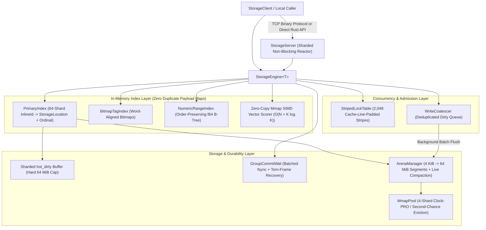

# Storine

[](LICENSE)
[](Cargo.toml)
[](Cargo.toml)

**Storine** is an ultra-fast, zero-copy, memory-mapped embedded storage engine and sharded non-blocking TCP server written in pure Rust with **zero third-party runtime dependencies**.

It is engineered for workloads requiring **sub-microsecond reads (`~200 ns` p50)**, **zero heap allocations on hot read paths**, **coalesced microsecond writes (`~5 µs` p50 with `SyncPolicy::AsyncMemoryFirst`)**, **hybrid secondary + SIMD vector search**, **bidirectional relational links (`1:1`, `1:N`, `M:N`)**, and **million-connection scalability (`~88 bytes` per idle TCP connection)**.

---

## Key Features

- **Zero-Copy Memory-Mapped Reads (`0.00 Allocs/Op`)**:
  - 64-byte cache-line-aligned record frames (`[RecordHeader (64B) | Relative-Offset Archive Payload]`) are memory-mapped directly from disk into virtual address space and read in place (`~200 ns` p50 via `StorageEngine::with_ref`) without deserializing or allocating heap memory. Bytes are validated once when first mapped; every later read is a safe O(1) bounds-checked decode, so corrupted or hostile bytes can never cause undefined behavior.
- **Dual-Tier Storage & Write Coalescing**:
  - Hot updates land immediately in a 64-way sharded in-RAM write buffer (`hot_dirty`, capped by `max_hot_dirty_bytes`) and are coalesced in the background into 4 KiB-growable, 64-byte-aligned arena segment files (`seg_XXXXX.dat`), eliminating up to **71.6% of redundant physical disk writes**.
- **Group-Commit Write-Ahead Log (WAL) & Torn-Frame Recovery**:
  - `SyncPolicy::Immediate` (`fsync` per write), `SyncPolicy::GroupCommit` (concurrent writers share one `fsync`), and `SyncPolicy::AsyncMemoryFirst` (buffered, written to the OS by the background flusher, never `fsync`ed: a crash can lose the last flush interval). Recovery ignores torn trailing frames and replays only committed transactions; the WAL fails stop on I/O errors instead of acknowledging writes of unknown durability.
- **End-to-End Hardware Checksum Verification**:
  - Every 64-byte `RecordHeader` and payload is protected by a 4-lane XXH64-family hash combined with a dual-lane `CRC32C` (SSE4.2 `_mm_crc32_u64` when available, a bit-identical portable table otherwise, so files are readable across builds and CPUs), catching single-bit flips on both disk and network paths.
- **Hybrid Indexing & $O(N + K \log K)$ SIMD Vector Search**:
  - **Primary Index**: 64-shard cache-line-padded hash index keyed by 24-byte stack-allocated `InlineId`s (`3 ns` hash + equality), persisted in a compact varint checkpoint (`primary.idx` at `~21 bytes/record`, ordinals included so persisted ordinal-keyed indexes survive restarts).
  - **Tag Index**: Word-aligned `CompactBitmap` inverted index driving multi-tag `AND`/`OR` intersections from the smallest posting list via hardware `TZCNT`.
  - **Numeric Range Index**: IEEE-754 order-preserving `BTreeMap` index supporting fast `[min, max]` range scans.
  - **Index Tiers**: `IndexTier::Memory` (default; rebuilt at open) or `IndexTier::Paged` (memory-mapped 4 KiB B+Tree pages and 512 B bitmap blocks; RAM bounded by page directories plus the recent delta; persisted at checkpoints and reused after a clean shutdown).
  - **Vector Similarity Search**: 8-way unrolled SIMD cosine similarity (`87 ns` per 64-dim vector) paired with Hoare/Floyd-Rivest Quickselect (`select_nth_unstable_by`) for linear $O(N)$ top-$K$ partitioning.
- **Deadlock-Free Bidirectional Relational Graph (`1:1`, `1:N`, `M:N`)**:
  - First-class `OneToOne`, `OneToMany`, and `ManyToMany` containers with canonical lock ordering (`StripedLockTable::lock_many`) that mathematically prevents AB-BA deadlocks during concurrent bidirectional link updates.
- **Encryption at Rest (optional)**:
  - `EngineConfig::encryption_key` seals every record frame on disk and in the WAL with ChaCha20-Poly1305, authenticated against its record id and metadata. Warm reads stay zero-allocation via a bounded decrypted-frame cache. Ids and indexed values in index files are not encrypted.
- **Sharded Non-Blocking TCP Server (`StorageServer`)**:
  - Fixed pool of `ReactorShard` worker threads multiplexing non-blocking sockets (`NonBlockingConn`, `~88 bytes` per idle connection) with zero-allocation vectored `IoSlice` socket writes and dynamic `max_connections` admission control.

---

## Architecture Overview



---

## Workspace Crates

| Crate | Path | Description |
| :--- | :--- | :--- |
| **`storage-types`** | [`crates/storage-types`](crates/storage-types) | Core primitives: 24-byte `InlineId`, 64-byte `RecordHeader`, `RecordOrdinal`, `Version`, `CachePadded<T>`, and unified `StorageError`. |
| **`storage-codec`** | [`crates/storage-codec`](crates/storage-codec) | Zero-copy relative-offset archive format (`ArchivedString`, `ArchivedSlice<T>`, `ArchivePod` + `impl_archive_pod!`), archived relationship types, `AlignedBytes`, LZ4-style compression, checksums, and RFC 8439 ChaCha20-Poly1305 primitives. |
| **`storage-mmap`** | [`crates/storage-mmap`](crates/storage-mmap) | Cross-platform OS memory mapping (Win32 `CreateFileMappingW` / POSIX `mmap`), 4-shard Clock-PRO `MmapPool`, and `ArenaManager` with live compaction. |
| **`storage-wal`** | [`crates/storage-wal`](crates/storage-wal) | `GroupCommitWal` batching concurrent durable writes, torn-frame-tolerant recovery, checkpoint truncation and optional WAL archiving for PITR. |
| **`storage-index`** | [`crates/storage-index`](crates/storage-index) | 64-shard `PrimaryIndex`, compact `STGEIDX2` checkpointing, `BitmapTagIndex`, `NumericRangeIndex`, and SIMD cosine similarity kernel. |
| **`storage-graph`** | [`crates/storage-graph`](crates/storage-graph) | Bidirectional `OneToOne`, `OneToMany`, and `ManyToMany` relational containers and referential integrity verifiers. |
| **`storage-core`** | [`crates/storage-core`](crates/storage-core) | Unified `StorageEngine<T>`, `RecordRef<T>`, `WriteCoalescer`, `StripedLockTable`, hybrid query planner, and chaos crash-recovery tests. |
| **`storage-server`** | [`crates/storage-server`](crates/storage-server) | Sharded non-blocking TCP event reactor (`StorageServer<T>`) and binary client (`StorageClient`) with runtime `max_connections` admission control. |
| **`storage-cli`** | [`crates/storage-cli`](crates/storage-cli) | Command-line inspection, CRUD, hybrid search, compaction, and diagnostics utility. |
| **`benches`** | [`benches`](benches) | Release benchmark harness with custom `TrackingAllocator` enforcing `0.00` heap allocations on hot read paths. |

---

## Quick Start

### 1. Embedded Engine Usage (Rust)

```rust
use storage_core::{AgentObjectRecord, EngineConfig, StorageEngine, FIELD_PRIMARY_TAG, FIELD_SCORE};
use storage_types::InlineId;

fn main() -> storage_types::Result<()> {
    let engine = StorageEngine::<AgentObjectRecord>::open("./data", EngineConfig::default())?;

    let id = InlineId::from_static("agent:atlas-01");
    let mut record = AgentObjectRecord::new(id, "Atlas Memory Node", 1_700_000_000, 950);
    record.tags = vec![InlineId::from_static("ai"), InlineId::from_static("memory")];
    record.embedding = vec![0.25; 64];

    // 1. Insert or overwrite (WAL-logged, then coalesced to disk in the background)
    let version = engine.put(id, &record)?;
    assert_eq!(version.0, 1);

    // 2. Zero-allocation read straight from the in-memory frame or mmap
    engine.with_ref(id, |view| {
        println!("Title: {}, Score: {}", view.get_str(&view.title), view.score);
    })?;

    // 3. Hybrid query: tag bitmap AND numeric range, then top-K SIMD vector similarity
    let ids = engine
        .query()
        .filter_tag(FIELD_PRIMARY_TAG, InlineId::from_static("ai"))
        .filter_range(FIELD_SCORE, 900..=1000)
        .execute_ids();
    let hits = engine
        .query()
        .filter_tag(FIELD_PRIMARY_TAG, InlineId::from_static("ai"))
        .top_k_similar(&[0.25; 64], 10);
    println!("{} range matches, top hit: {:?}", ids.len(), hits.first().map(|(id, _)| *id));

    // 4. Make everything durable on disk before exiting
    engine.flush_all()?;
    Ok(())
}
```

### 2. Network Server & Client Usage

```rust
use std::sync::Arc;
use storage_core::{AgentObjectRecord, EngineConfig, StorageEngine};
use storage_server::{decode_agent_frame, StorageClient, StorageServer};
use storage_types::InlineId;

fn main() -> storage_types::Result<()> {
    let engine = Arc::new(StorageEngine::<AgentObjectRecord>::open(
        "./server_data",
        EngineConfig::default(),
    )?);

    // Without authentication the server only accepts a loopback bind address.
    let mut server = StorageServer::start_with_max_connections(
        "127.0.0.1:7878",
        Arc::clone(&engine),
        250_000,
    )?;

    // Adjust the connection ceiling at runtime without restarting
    server.set_max_connections(500_000);

    let mut client = StorageClient::connect(server.local_addr())?;
    let id = InlineId::from_static("net:item-01");
    let rec = AgentObjectRecord::new(id, "Zero-Copy Network Record", 1_700_000_000, 42);

    client.put(id, &rec)?;
    let frame = client.get_frame(id)?;
    let view = decode_agent_frame(&frame)?;
    assert_eq!(view.get_str(&view.title), "Zero-Copy Network Record");

    server.stop();
    Ok(())
}
```

For a network-reachable server, build a `SecurityConfig` with tokens (`SecurityConfig::new(true).with_token(token, RbacRole::ReadWrite)`) and start the server with it with `StorageServer::start_with_config(addr, engine, max_connections, security)`; clients call `client.authenticate(token)` first. The standalone binary reads the same settings from `STORAGE_AUTH_TOKENS` (below).

---

## CLI & Standalone Server

### Build All Binaries
```bash
cargo build --release
```

### Run the TCP Server
```bash
# Default (./server_data on 127.0.0.1:7878, max_connections = 100,000, no authentication)
cargo run --release -p storage-server

# Network-reachable server: authentication is mandatory for non-loopback addresses
STORAGE_AUTH_TOKENS="change-me-admin-token:admin,change-me-app-token1:write" \
STORAGE_BACKUP_ROOT=./backups \
cargo run --release -p storage-server -- ./server_data 0.0.0.0:7878 --max-connections 500000
```
Environment settings:
- `STORAGE_AUTH_TOKENS`: comma-separated `token:role` pairs (`read`, `write`, `admin`; tokens of at least 16 characters). Without it the server refuses any non-loopback bind address.
- `STORAGE_BACKUP_ROOT`: directory under which remote `OP_ADMIN_BACKUP` may create backups (disabled when unset).
- `STORAGE_RATE_LIMIT`: per-connection `rps:burst` token bucket.
- `STORAGE_MAX_CONNECTIONS`: connection ceiling (overridden by `--max-connections`).

### Run the CLI Utility
```bash
cargo run --release -p storage-cli -- put ./data agent_01 "Primary Node" 100 "ai,core"
cargo run --release -p storage-cli -- get ./data agent_01
cargo run --release -p storage-cli -- stats ./data
cargo run --release -p storage-cli -- compact ./data
```
Backups and point-in-time recovery: `backup <db_dir> <backup_dir>`, `archive-wal <db_dir> <backup_dir>`, `restore-pitr <backup_dir> <restore_dir> <ts_ns>` (these open the engine with WAL archiving enabled, which PITR requires). Remote admin commands (`remote-health`, `remote-backup`, ...) authenticate with `STORAGE_TOKEN`.

---

## Verified Benchmarks & Footprint

Measured with `cargo run --release -p storage-benches` (`opt-level = 3`, `lto = "fat"`, `codegen-units = 1`, `-C target-cpu=native`) with allocation tracking enabled. The engine benchmarks use `SyncPolicy::AsyncMemoryFirst` (no `fsync` per write), so write latencies are memory-first numbers, not durable-commit numbers.

| Workload | `p50` Latency | Heap Allocs / Op |
| :--- | ---: | ---: |
| **`InlineId` (24B) Hash + Eq** | `1–3 ns` | **`0.00`** |
| **Zero-Copy `RecordView` Read + `get_str` (`decode_unchecked`)** | `~8–15 ns` *(includes the per-call UTF-8 check that makes `as_str` sound)* | **`0.00`** |
| **SIMD Cosine Similarity (`64-dim f32`, 8-way unrolled)** | `87 ns` | **`0.00`** |
| **`StorageEngine::with_ref` (0-Alloc Hot Read)** | **`~200–300 ns`** | **`0.00`** |
| **`StorageEngine::get_ref` (Mmap Arena Segment)** | **`~300–500 ns`** | **`0.00`** |
| **Checksum (`XXH64-family + CRC32C`, 4 KB)** | `~1.6–1.9 µs` | **`0.00`** |
| **`StorageEngine::update` (Coalesced Hot Write)** | **`~5–6 µs`** | `5.00` |
| **Secondary Index (`Tag Bitmap + B+Tree Range`)** | **`~7–15 µs`** | `1.00` |
| **`StorageServer` TCP Binary `GET` Frame RPC (loopback)** | **`~70–180 µs`** | `3.00` *(client side)* |

Ranges reflect run-to-run variance on the (shared) development machine; see the report for interleaved baseline-vs-candidate measurements.

### Memory & Disk Efficiency Highlights
- **Per-Connection Server Footprint**: `~88 bytes` per idle `NonBlockingConn` (`~88 MB` for 1,000,000 idle connections vs `~2.1 TB` for thread-per-connection servers).
- **Primary Index Checkpoint (`primary.idx`)**: `~21 bytes / record` (`4.2x` smaller than the fixed-row v1 format via varint + compact `InlineId` encoding).
- **Persisted Vector Graph (`hnsw.idx`)**: saved at checkpoints and reused at open (reconciled against the records), so restarts do not rebuild the HNSW graph.
- **Zero Duplicate In-RAM Index/Vector Maps**: Secondary index snapshots and float embeddings are read zero-copy directly from the memory-mapped `&T::Archived` frame (`0 bytes/record` of duplicate heap maps).
- **Release Binaries**: `storage-server` is a self-contained **`582 KiB`** binary (Windows x86_64; `516 KiB` before the 2026-10-20 audit fixes).

See [`docs/BENCHMARK_REPORT.md`](docs/BENCHMARK_REPORT.md) for the complete latency and footprint verification report.

---

## Contributing

Contributions are welcome! Please read [`CONTRIBUTING.md`](CONTRIBUTING.md) for our architecture invariants, safety rules, and testing workflow before submitting a pull request.

---

## License

Dual-licensed under either of:

- **MIT License** ([`LICENSE`](LICENSE) or <https://opensource.org/licenses/MIT>)
- **Apache License, Version 2.0** ([`LICENSE-APACHE`](LICENSE-APACHE) or <https://www.apache.org/licenses/LICENSE-2.0>)

at your option.
