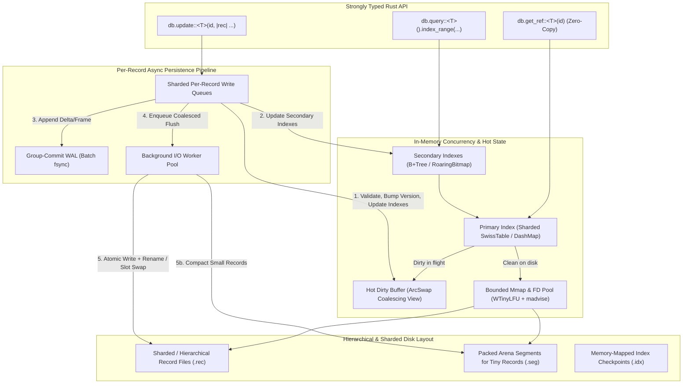
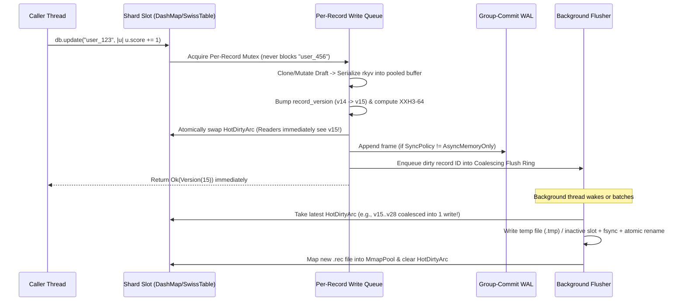

# End-to-End Implementation Plan: High-Performance Zero-Copy Object Storage Engine

## 1. Executive Summary & Architectural Vision

This project builds an ultra-fast, low-footprint, **zero-copy memory-mapped object storage engine** in **Rust**, designed specifically for read-heavy, hierarchical, and relationship-rich workloads (such as AI agent memory/state layers like Skyla, local-first software, knowledge graphs, and real-time configuration stores).

### Core Engineering Mandate
1. **Zero-Copy Reads (`mmap` + `rkyv`)**: Reads resolve directly to OS virtual memory pages mapped into process space and return zero-copy archived views (`&Archived<T>`) in nanoseconds—**zero heap allocations, zero deserialization parsing, zero memory copies**.
2. **Fine-Grained Concurrent Writes with Coalescing**: Updates target a controlled transactional closure (`db.update(id, |rec| ...)`), immediately update the in-memory hot view for instant reader visibility, and enqueue onto a **per-record serialized write queue**. Concurrent updates to different records never contend; rapid updates to the same record coalesce in memory before background atomic disk flush.
3. **Minimal CPU & Memory Footprint**: Strict bounds on resident memory, open file descriptors, and active `mmap` handles via shard-aware Clock-Pro / W-TinyLFU caching, 64-byte cache-line alignment (`#[repr(C, align(64))]`) to eliminate false sharing, inline stack types (`SmallVec`, inline 24-byte `RecordId`) to avoid heap allocations, and SIMD-accelerated hashing/checksums (`XXH3` / hardware `CRC32C`).
4. **Explicit Graph & Hierarchical Data Model**: First-class `1:1`, `1:N`, and `M:N` relationships stored directly as compact inline ID lists inside parent/child records (no SQL join tables), combined with physical parent-folder hierarchy grouping and secondary indexes.

---

## 2. System Architecture

### 2.1 High-Level Data Flow



---

## 3. Cargo Workspace & Crate Modularity

To keep compile times fast, enforce strict `unsafe` boundaries, and allow independent benchmarking of every layer, the codebase is structured as a multi-crate Cargo workspace:

```text
storage-engine/
├── Cargo.toml                 # Workspace root (fat LTO, codegen-units=1, panic=abort)
├── docs/                      # Architecture, Features, Rules, and Tasks docs
├── crates/
│   ├── storage-types/         # Zero-allocation RecordId, Version, Error, Header structs
│   ├── storage-codec/         # rkyv zero-copy traits, XXH3/CRC32C checksums, schema versioning
│   ├── storage-mmap/          # Cross-platform mmap wrapper, MmapPool, FD limiter, OS page hints
│   ├── storage-wal/           # Group-commit Write-Ahead Log & crash recovery replay
│   ├── storage-index/         # Primary SwissTable index, B+Tree range index, RoaringBitmap tags
│   ├── storage-graph/         # Explicit 1:1/1:N/M:N relationship lists & referential integrity
│   ├── storage-core/          # Per-record write queues, write coalescer, transactions, Engine API
│   ├── storage-cli/           # CLI for inspection, stats, compaction, backup, and repair
│   └── storage-server/        # Optional low-latency binary TCP/UDS server & client SDK
└── benches/                   # Criterion micro/macro benchmarks & allocation trackers
```

---

## 4. Deep-Dive Subsystem Design

### 4.1 Zero-Copy Binary Record Format (`storage-types` & `storage-codec`)

Every record (whether stored in a dedicated `.rec` file or packed inside a `.seg` arena) begins with a **fixed 64-byte cache-line-aligned header** (`#[repr(C, align(64))]`), followed immediately by the 16-byte-aligned `rkyv` archived payload:

```text
+-----------------------------------------------------------------------+
| Offset | Size | Field            | Description                        |
+--------+------+------------------+------------------------------------+
| 0..4   | 4B   | magic            | 0x53544745 ("STGE")                |
| 4..6   | 2B   | format_version   | Storage wire format version (u16)  |
| 6..8   | 2B   | schema_version   | User struct schema version (u16)   |
| 8..16  | 8B   | record_version   | Monotonic OCC version counter (u64)|
| 16..24 | 8B   | updated_at_ns    | UTC UNIX timestamp in ns (u64)     |
| 24..32 | 8B   | checksum         | XXH3-64 hash of payload bytes      |
| 32..36 | 4B   | payload_len      | Exact byte length of rkyv payload  |
| 36..40 | 4B   | root_offset      | rkyv root relative offset (u32)    |
| 40..42 | 2B   | flags            | Tombstone, Compressed, Pinned, etc.|
| 42..64 | 22B  | reserved / inline| Reserved / inline parent key hash  |
+--------+------+------------------+------------------------------------+
| 64..N  | Var  | payload          | 16B-aligned rkyv Archived<T> bytes |
+-----------------------------------------------------------------------+
```

- **Why `rkyv`**: Unlike Protobuf, Bincode, or JSON, `rkyv` writes relative pointers on serialization so the on-disk byte representation **is** the in-memory layout.
- **Validation vs. Hot Path**:
  - When a record file is first mapped or recovered after an unclean shutdown, `rkyv::check_archived_root` + `XXH3-64` checksum verification runs once to prove structural and bitwise integrity.
  - Once verified, a `VerifiedBit` is set on the `MmapSlot`, and subsequent reads execute `unsafe { rkyv::archived_value::<T>(slice, root_offset) }` in **~1–2 CPU cycles** with zero validation overhead.

### 4.2 Hybrid Storage Layout: Record-Per-File + Adaptive Arena Segments (`storage-mmap`)

The initial design specifies **one record per file** with **parent folder grouping** for tightly coupled hierarchies. As noted in the architectural analysis, pure record-per-file excels at isolation and zero-copy simplicity, but 10M+ tiny files can strain OS inode tables and file descriptor limits.

We implement a **Two-Tier Hybrid Storage Layout** that preserves every advantage of record-per-file while scaling effortlessly to tens of millions of records:

1. **Hierarchy & Sharded Record-Per-File Mode (`StorageLayout::RecordPerFile` / Default for Medium-Large & Grouped Records)**:
   - Records belong to a collection or parent hierarchy path:
     `data/<hierarchy_path>/<2-char-blake3-shard>/<record_id>.rec`
   - Tightly coupled child records (e.g., `users/user_123/profile.rec`, `users/user_123/preferences.rec`, `users/user_123/tasks/...`) can be co-located under a shared parent directory or co-mapped into a single **Hierarchy Bundle File (`users/12/user_123.bundle`)** so an entire entity subtree maps into a single contiguous virtual memory page!
2. **Adaptive Arena Segment Mode (`StorageLayout::Adaptive` for High-Count Small Records)**:
   - Records smaller than a configurable threshold (e.g., `< 4 KB`) can be packed at 64-byte boundaries into 64 MB memory-mapped **Slotted Arena Segments** (`segments/seg_00001.dat`), while records `>= 4 KB` (or explicitly isolated records) get dedicated `.rec` files.
   - Because both `.rec` files and `.seg` slices expose the exact same 64-byte header + `rkyv` payload slice via a `RecordGuard<'a, T>`, the upper engine API is 100% identical across both modes.
3. **Bounded FD & Mmap Pool**:
   - The OS has finite virtual memory map areas (`vm.max_map_count` on Linux, handle quotas on Windows).
   - `MmapPool` maintains a lock-free sharded W-TinyLFU / Clock cache of active `Mmap` handles. When active mappings reach `max_open_mmaps` (e.g., 16,384), the coldest unpinned `Mmap` (where `active_readers == 0`) is cleanly unmapped.

### 4.3 Concurrency, Per-Record Write Queues & Write Coalescing (`storage-core`)



- **Why Readers Never Block**:
  - Each active record entry in the primary index holds a `RecordState` containing either:
    1. `HotBuffer(Arc<AlignedBytes>)` — the latest in-memory serialized `rkyv` frame waiting to be flushed to disk, or
    2. `MappedFile(MmapSliceRef)` — a zero-copy reference into the memory-mapped `.rec` or `.seg` file.
  - Readers load an `Arc` pointer via `ArcSwapAny` (wait-free, no mutex, no atomic RMW contention on the fast path when using thread-local hazard/epoch guards) and immediately dereference `&T::Archived`.
- **Why Writes to Different Records Run in Parallel**:
  - Locking is strictly **per-record** (implemented via a 2048-way striped lock table + per-active-record queue node). Updating `user_123` has zero interaction with `user_456`.
- **Write Coalescing**:
  - If `user_123` is updated 1,000 times in 5 milliseconds, all 1,000 updates happen at RAM speed against the in-memory `rkyv` buffer, and the background flusher performs **only 1 atomic file replacement** on disk for version `+1000`.
- **Atomic File Replacement & Pre-Allocated Double Buffering**:
  - **Mode A (Standard Atomic Rename)**: Write to `<id>.rec.tmp` (pooled temp file), `fsync` data, and atomically rename over `<id>.rec` (`MoveFileExW` with `MOVEFILE_REPLACE_EXISTING` on Windows; `rename()` on POSIX).
  - **Mode B (Zero-Allocation Ping-Pong Slot)**: To avoid filesystem directory metadata churn on hot records, a `.rec` file can pre-allocate two slots (`Slot 0` and `Slot 1`) with an atomic 64-byte root header toggle. Writes go directly into the inactive slot via `pwrite`/`WriteFile` without creating or renaming files!

### 4.4 Primary & Secondary Indexing (`storage-index`)

1. **Primary Index (`RecordId -> RecordMeta`)**:
   - `RecordId` is a 24-byte stack-inlined value (`InlineId`: up to 23 UTF-8 bytes inline on the stack without heap allocation, falling back to `Arc<str>` only for keys > 23 bytes).
   - Stored in a **64-shard `hashbrown::HashTable`** using `XXH3` hashing.
   - Persisted to a memory-mapped checkpoint file (`index/primary.idx`) so startup takes `< 5 ms` without scanning directories.
2. **Secondary Indexes**:
   - **Numeric & Timestamp Range Indexes**: Cache-conscious **B+Tree** (`BTreeIndex<K>`) with 256-byte SIMD-searchable internal nodes mapping `FieldValue -> SmallVec<[CompactRecordKey; 4]>`.
   - **Equality / Tag / Categorical Indexes**: **RoaringBitmaps** (`RoaringTreemap` over dense 32-bit internal `RecordOrdinal`s) enabling sub-microsecond set intersections (`AND`, `OR`, `AND NOT`) across multiple secondary conditions before touching a single record file.
   - **Atomic Index Maintenance**: When `db.update(id, |u| ...)` runs, the engine extracts indexed keys before and after the closure. Only if an indexed field actually changed does it compute the index delta `(old_val -> remove, new_val -> insert)` and apply it atomically alongside the version bump.

### 4.5 Explicit Relationships & Hierarchical Integrity (`storage-graph`)

- No join tables. Relationships are represented directly inside records via typed zero-copy link containers:
  - `OneToOne<Target>`: Stores an optional `InlineId` (plus cached `RecordOrdinal` hint for O(1) lookup).
  - `OneToMany<Target>` / `ManyToMany<Target>`: Stores a sorted, deduplicated `ArchivedVec<InlineId>` inside the record payload.
- **Bidirectional Link Helpers & Referential Integrity**:
  - `db.link::<User, Post>(user_id, post_id)` atomically updates both sides' write queues in deterministic ID order (lowest ID locked first to guarantee zero deadlocks).
  - Configurable deletion policies per relationship edge:
    - `OnDelete::Restrict` (abort delete if referenced)
    - `OnDelete::Cascade` (recursively delete child records)
    - `OnDelete::Unlink` (remove deleted ID from related records' link lists)

---

## 5. Phased Implementation Roadmap

### Phase 0: Project Scaffolding, Profiling & Benchmark Harness
- Initialize Cargo workspace, release optimization profiles (`lto = "fat"`, `codegen-units = 1`), `mimalloc` global allocator, and linting rules (`clippy::pedantic`, `unsafe_op_in_unsafe_fn`).
- Build the allocation-counting test harness and `Criterion` microbenchmark suite so every subsequent commit is measured for latency, throughput, CPU cycles, and heap allocations.

### Phase 1: Core Types, Zero-Copy `rkyv` Codec & Cross-Platform `mmap`
- Implement `InlineId` (stack-inlined primary key), `RecordHeader` (`#[repr(C, align(64))]`), and `XXH3-64` / `CRC32C` hardware-accelerated checksumming.
- Implement `storage-codec` traits wrapping `rkyv` serialization into thread-local reusable aligned `AlignedVec` scratch buffers (zero heap allocation after warmup).
- Implement `storage-mmap` for Windows (`CreateFileMappingW`/`MapViewOfFile`) and Unix (`mmap`/`madvise`), plus the bounded `MmapPool` with W-TinyLFU eviction and reader reference guards.

### Phase 2: Sharded/Hierarchical File Storage & Atomic Disk Persistence
- Implement `PathResolver` supporting both 2-level hex sharding and logical parent-folder grouping (`hierarchy/parent_id/child_id.rec`), plus Hierarchy Bundle files and Ping-Pong double-buffered record files.
- Implement atomic write-replace (`.tmp` + fsync + atomic rename) and pre-allocated slot updates.
- Implement the memory-mapped Primary Index (`primary.idx`) and fast startup loader.

### Phase 3: Per-Record Concurrency, Write Coalescing & Group-Commit WAL
- Implement the 2048-way striped per-record write queue and `HotDirtyBuffer` (`ArcSwap`) for immediate wait-free read visibility after mutation.
- Implement the closure-based mutation API (`db.insert`, `db.get_ref`, `db.update`, `db.compare_and_update` with OCC `record_version`).
- Implement `storage-wal` with Group Commit (batching concurrent threads' WAL appends into a single `fsync`) and deterministic crash-recovery replay.
- Implement the background async flusher worker pool with write coalescing.

### Phase 4: Secondary Indexes & Zero-Allocation Query Engine
- Implement the `Indexable` trait allowing user types to declare indexed timestamp, numeric, and tag fields.
- Implement the cache-conscious B+Tree range index and RoaringBitmap equality/tag index, with atomic delta updates on record mutation/deletion.
- Build the zero-allocation iterator-based Query API (`db.query::<T>().range(...).filter_tag(...)`).

### Phase 5: Explicit Relationships, Hierarchies & Referential Integrity
- Implement `Ref<T>`, `RefList<T>`, and bidirectional relationship mutations (`link`, `unlink`) with deterministic lock ordering.
- Implement `Cascade`, `Restrict`, and `Unlink` delete policies and background orphan verification.
- Implement zero-copy graph traversal iterators (`db.traverse_children::<Parent, Child>(id)`).

### Phase 6: Multi-Record Transactions, Schema Evolution & Snapshots
- Implement multi-record atomic transactions (`db.transaction(|txn| ...)`) using deterministic sorted lock acquisition + single-frame WAL commit record.
- Implement schema evolution (`schema_version` in `RecordHeader` + lazy zero-downtime migration hooks on read/compaction).
- Implement point-in-time consistent snapshots and online incremental backup.

### Phase 7: Adaptive Arena Compaction, Cold Compression & AI Extensions
- Implement the Adaptive Arena Segment packer (`seg_XXXXX.dat`) for sub-4KB records and background compaction of dead slots.
- Implement optional LZ4 / Zstd dictionary compression for cold archived records.
- Implement AI-native state primitives (fixed-dimension SIMD cosine/dot-product vector scan over `mmap` float/int8 arrays, conversation ring buffers, TTL expiration).

### Phase 8: CLI, Network Server & Chaos Verification Suite
- Build `storage-cli` (`inspect`, `bench`, `verify`, `compact`, `backup`).
- Build `storage-server` (custom length-prefixed zero-copy binary protocol over TCP/UDS) for multi-process / multi-node access with cache invalidation notifications.
- Run the Chaos Crash-Testing Suite (killing worker processes mid-write across 10,000+ randomized operations and verifying zero corruption and 100% WAL durability).
