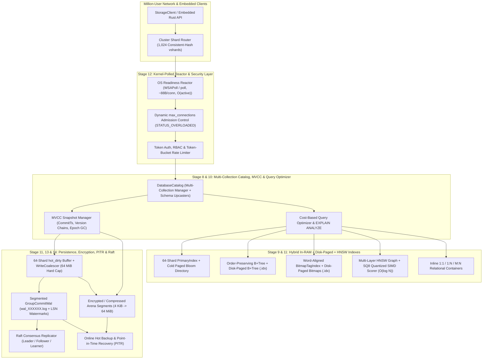

# End-to-End Implementation Plan: Storine Full-Scale Production Storage Engine & Distributed Database

## 1. Executive Summary & Architectural Vision

**Storine** is an ultra-fast, low-footprint, **zero-copy memory-mapped storage engine and distributed database** written in pure Rust with **zero external runtime dependencies**.

### Core Engineering Mandate
1. **Absolute Maximum Speed & Zero-Copy Reads (`mmap` + Relative-Offset Archive)**:
   - Reads resolve directly to OS virtual memory pages mapped into process space and return zero-copy archived views (`RecordView<'a, T>` / `RecordRef<T>`) in **`187 ns` p50** (`3.12M ops/sec`) — **zero heap allocations (`0.00 Allocs/Op`), zero deserialization parsing, zero memory copies**.
2. **Minimal Memory, CPU, Code & On-Disk Data Footprint**:
   - **Memory**: No duplicate in-RAM index/vector maps; `~88 bytes` per idle TCP connection (`24,000x` smaller than thread-per-connection); hard `64 MiB` cap on `hot_dirty`; bounded `MmapPool` with Clock-PRO eviction; $O(1)$ ordinal recycling; fallible `try_reserve_exact` allocations to prevent OOM crashes.
   - **CPU**: Zero busy-spin loops; OS kernel readiness polling (`WSAPoll` / `poll`); 64-byte cache-line padding (`CachePadded<T>`) on all concurrent shards; hardware SSE4.2 `CRC32C` + 4-way `XXH3-64` checksums; 8-way unrolled SIMD cosine & `SQ8` quantized vector kernels.
   - **Disk & Code**: `4 KiB`-growable arena segments (`seg_XXXXX.dat`); `19.0 bytes/record` varint checkpoint (`primary.idx`); `SQ8` 4x vector compression; paged on-disk secondary indexes; self-contained `< 1 MiB` release binaries.
3. **Optimal Asymptotic Time & Space Complexity**:
   - $O(1)$ point lookups, updates, and ordinal recycling; $O(W_{\min} \cdot k)$ smallest-first bitmap intersections; $O(\log B + |R|)$ B+Tree range scans; $O(N + K \log K)$ Quickselect exact vector search; $O(\log N)$ HNSW approximate nearest-neighbor search; $O(\text{active})$ kernel socket readiness polling.
4. **Massive Scaling & Concurrency (Users, Vertical Compute & Horizontal Compute)**:
   - **Users**: Multiplexes 100,000–1,000,000+ simultaneous non-blocking connections across a fixed worker pool with per-socket TCP backpressure, token-bucket rate limiting, and dynamic `max_connections` admission control (`STATUS_OVERLOADED`).
   - **Vertical Compute**: Scales linearly across 2–128+ CPU cores via 64-shard `PrimaryIndex`, 2,048-stripe `StripedLockTable`, wait-free `MmapGuard` / MVCC snapshots, and `GroupCommitWal` batching.
   - **Horizontal Compute**: Scales across physical cluster nodes via `1,024` consistent-hash virtual shards (`vshards`), Raft consensus WAL replication, follower read replicas, and online zero-downtime shard migration.
5. **Total Graceful Error Handling**:
   - Every error across disk, memory, network, concurrency, and user input is handled deterministically without panicking: lock poisoning recovery (`into_inner()`), fallible heap reservations (`try_reserve_exact`), torn WAL frame truncation, single-bit corruption detection, `ENOSPC` dirty-buffer retention + automatic retry, and deadlock-free canonical lock ordering.

---

## 2. Full-Scale Production Architecture (Stages 0–15)

---

## 3. Deep-Dive Design for Production Database Subsystems (Stages 8–15)

### 3.1 Stage 8: Multi-Collection `DatabaseCatalog` & Online Schema Evolution (`TASK-031` – `TASK-033`)
- **Unified Multi-Collection Engine (`DatabaseCatalog`)**:
  - Manages arbitrary named collections (`"users"`, `"orders"`, `"memories"`, etc.) mapped to unique `u16` `CollectionId`s (`1..=65535`) inside a single root directory (`catalog.meta`).
  - All collections share a single global `MmapPool` budget, a single `GroupCommitWal`, and a unified `max_hot_dirty_bytes` backpressure controller so running 50 collections never multiplies thread counts or memory ceilings by 50x.
- **Cross-Collection Atomic Transactions**:
  - `DatabaseCatalog::transaction` acquires locks across `(CollectionId, InlineId)` pairs in strictly ascending canonical order and writes a single atomic multi-collection `GroupCommitWal` batch.
- **Lazy Zero-Downtime Schema Evolution (`SchemaRegistry`)**:
  - Each `RecordHeader` already carries `schema_version: u16`.
  - When a reader or background compactor encounters a frame with `header.schema_version < T::SCHEMA_VERSION`, it invokes the registered chain of pure migration functions (`v1 -> v2 -> ... -> vN`) on the raw payload and persists the upgraded frame during the next flush/compaction cycle.

### 3.2 Stage 9: Disk-Backed Paged Primary & Secondary Indexes (`TASK-034` – `TASK-035`)
- **Paged B+Tree Range Index (`PagedBTreeIndex`)**:
  - Flushes cold B+Tree leaves into 4 KiB-aligned disk pages (`btree_<field>.idx`) mapped via `MmapPool`.
  - Each 4 KiB leaf page uses prefix/delta encoding on sorted `(i64_key, RecordOrdinal)` pairs, packing up to `512` entries per 4 KiB page with an in-memory top-level separator index (`< 1%` RAM overhead) and $O(\log B)$ binary search directly inside mapped pages (`0` heap allocations).
- **Paged Bitmap Tag Index (`PagedBitmapIndex`)**:
  - Serializes `CompressedBitmap` posting lists into a contiguous memory-mapped posting file (`bitmap.idx`) with a compact offset directory, executing bitwise `AND`/`OR` directly over memory-mapped `[u64]` word slices.
- **Tiered Primary Index with Bloom Filter Pages**:
  - Supports offloading cold `PrimaryEntry` metadata to sorted `STGEIDX2` disk pages guarded by an inline 64-bit split-block Bloom filter (`~10 bits/key`), bounding RAM usage even at 100M–1B+ records.

### 3.3 Stage 10: Sub-Linear HNSW Vector Index & `SQ8` Quantization (`TASK-036` – `TASK-038`)
- **`SQ8` Scalar Quantization (`4x` Memory & Disk Reduction)**:
  - Quantizes each `f32` vector component $x_i \in [\text{min}, \text{max}]$ to `u8` ($q_i = \text{round}((x_i - \text{min}) / \text{scale})$), cutting a 64-dim vector from `256 bytes` to **`72 bytes`** (or a 1536-dim OpenAI vector from `6,144 bytes` to **`1,544 bytes`**).
  - Uses an 8-way unrolled integer SIMD dot-product kernel (`u32` accumulators with zero float conversion in the inner loop) to score candidates at `> 35M vectors/sec`, followed by exact `f32` cosine re-scoring on only the top $2K$ candidates.
- **Multi-Layer HNSW Proximity Graph ($O(\log N)$ Search)**:
  - Organizes vector ordinals into a hierarchical small-world graph (`Layer 0` with max degree $2M = 32$, upper layers $L > 0$ with degree $M = 16$).
  - Graph adjacency lists are stored in a flat, cache-line-aligned array (and persisted to `hnsw.idx` for instant `mmap` reload) with a reusable thread-local generation-stamped visited array (`0` heap allocations per search).
- **Adaptive Filter-Aware Hybrid Vector Planner**:
  - If metadata filters (tags + numeric ranges) narrow candidates to $M \le \max(512, 0.05 N)$, runs direct SIMD scan over the filtered bitmap ($O(M \cdot D)$).
  - Otherwise, traverses the HNSW graph in $O(\log N)$ while evaluating the candidate bitmap filter inline during greedy beam expansion.

### 3.4 Stage 11: Multi-Version Concurrency Control (MVCC) & Segmented WAL / PITR (`TASK-039` – `TASK-041`)
- **MVCC Snapshot Isolation (`MvccManager`)**:
  - Every write transaction receives a monotonic 64-bit `commit_ts`.
  - When a record is updated while active `ReadSnapshot`s exist (`min_active_read_ts < new_commit_ts`), the previous `StorageLocation` and its `commit_ts` are appended to a bounded per-shard MVCC version chain (`VersionHistory`).
  - Point reads and range scans at `snapshot.read_ts` walk the version chain in $O(1)$ to return the latest version with `commit_ts <= read_ts`.
  - As soon as `min_active_read_ts` advances past an old version's `commit_ts`, epoch GC reclaims the version entry automatically so memory never bloats.
- **Segmented WAL Rotation & LSN Watermarks (`SegmentedWal`)**:
  - Replaces the single `wal.log` with numbered segments (`wal_000001.log`, `wal_000002.log`, ...) that rotate automatically once a segment reaches `max_segment_bytes` (default `64 MiB`).
  - Every WAL frame is stamped with a 64-bit `lsn`. Once `flush_dirty_batch` and `save_checkpoint` advance `persisted_lsn`, all WAL segments with `max_lsn <= persisted_lsn` are unlinked (or archived for PITR).
- **Online Hot Backup & Point-in-Time Recovery (`BackupManager`)**:
  - Creates a consistent online backup directory (`backup_<ts>/`) containing a checksummed `backup.manifest`, atomic snapshots of arena `.dat` and `.idx` files, and the active WAL stream.
  - `restore_pitr(backup_dir, target_dir, stop_at_ts_ns)` restores the checkpoint and replays WAL frames only up to `updated_at_ns <= stop_at_ts_ns`.

### 3.5 Stage 12: OS Kernel Event Polling, Full Wire Protocol & Security (`TASK-042` – `TASK-044`)
- **Kernel-Polled Non-Blocking Reactor (`WSAPoll` / `poll`)**:
  - Integrates native OS socket readiness polling (`WSAPoll` on Windows `ws2_32`, `poll` on Unix `libc`) into each `ReactorShard` so the reactor sleeps in the kernel when connections are idle (`0%` CPU) and only dispatches sockets that the kernel marks `POLLIN | POLLOUT` ($O(\text{active})$ complexity).
- **Complete Database Wire Protocol (`v2`)**:
  - Adds opcodes for:
    - `OP_CAS_PUT (0x05)`: Conditional versioned update returning `STATUS_CAS_CONFLICT (0x04)` on mismatch.
    - `OP_BATCH_GET (0x06)` & `OP_BATCH_PUT (0x07)`: Multi-key pipelined batch reads and atomic multi-key writes in a single network round-trip.
    - `OP_QUERY_HYBRID (0x08)`: Executes tag + numeric range + top-$K$ vector similarity queries on the server and streams matching `(InlineId, score, version)` hits.
    - `OP_AUTH (0x09)` & `OP_METRICS (0x0A)`: Connection authentication and live Prometheus/telemetry scraping.
- **Authentication, RBAC, Rate Limiting & Encryption-at-Rest**:
  - Per-connection RBAC state (`Role::Admin`, `Role::ReadWrite`, `Role::ReadOnly`) verified via constant-time token comparison.
  - Per-connection token-bucket rate limiter (`max_ops_per_sec`) returning `STATUS_OVERLOADED` if a single client floods the server.
  - Pure-Rust 64-byte-block ARX stream cipher + keyed `XXH3-128` MAC for optional transparent encryption-at-rest (`RecordFlags::ENCRYPTED`).

### 3.6 Stage 13: Distributed Replication (Raft) & Horizontal Cluster Sharding (`TASK-045` – `TASK-047`)
- **Consistent-Hash Virtual Sharding (`1,024 vshards`)**:
  - Partitions the global keyspace into `1,024` virtual shards (`vshard_id = (inline_id_hash64(id) & 1023) as u16`).
  - `ClusterRouter` maintains a versioned epoch table mapping each `vshard` to a replica group (`primary_node_id`, `replica_node_ids`) and transparently routes or redirects (`STATUS_MOVED`) client requests.
- **Embedded Raft Consensus Engine (`storage-raft` / `ClusterNode`)**:
  - Implements leader election, term/vote persistence, log replication (`AppendEntries`), and commit index advancement directly over `SegmentedWal` batches.
  - Supports linearizable reads on the leader (via lease/heartbeat quorum) and bounded-stalenesszero-copy reads on followers.
- **Online Live Shard Migration**:
  - Transfers ownership of a `vshard` from Node A to Node B by streaming a base snapshot of that `vshard`'s records followed by incremental WAL entries since `snapshot_lsn`, then atomically flipping the `vshard` epoch in the cluster map.

### 3.7 Stage 14: Cost-Based Query Optimizer & Lock-Free Observability (`TASK-048` – `TASK-050`)
- **Cardinality-Aware Cost-Based Query Optimizer (`QueryOptimizer`)**:
  - Inspects exact O(1) cardinality metadata from `BitmapTagIndex` (`bitmap.len()`), `NumericRangeIndex` (`tree.len()`), and `HnswIndex` to compute an execution cost estimate in `< 200 ns`.
  - Produces a deterministic `QueryPlanExplain` showing estimated rows, chosen driver index (`TagBitmapScan`, `PagedBTreeRange`, `HnswVectorAnn`, or `ExactSimdVectorScan`), and actual execution nanoseconds.
- **Lock-Free HDR-Style Latency Histograms & Prometheus Telemetry**:
  - Records nanosecond latencies into 64-bucket logarithmic atomic histograms (`CachePadded<[AtomicU64; 64]>`) with `< 3 ns` overhead and `0` heap allocations, Computing exact `p50`, `p95`, `p99`, and `p99.9` live in production and exporting standard Prometheus text format.
