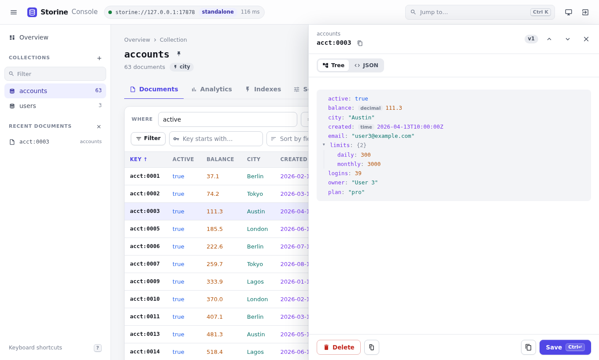
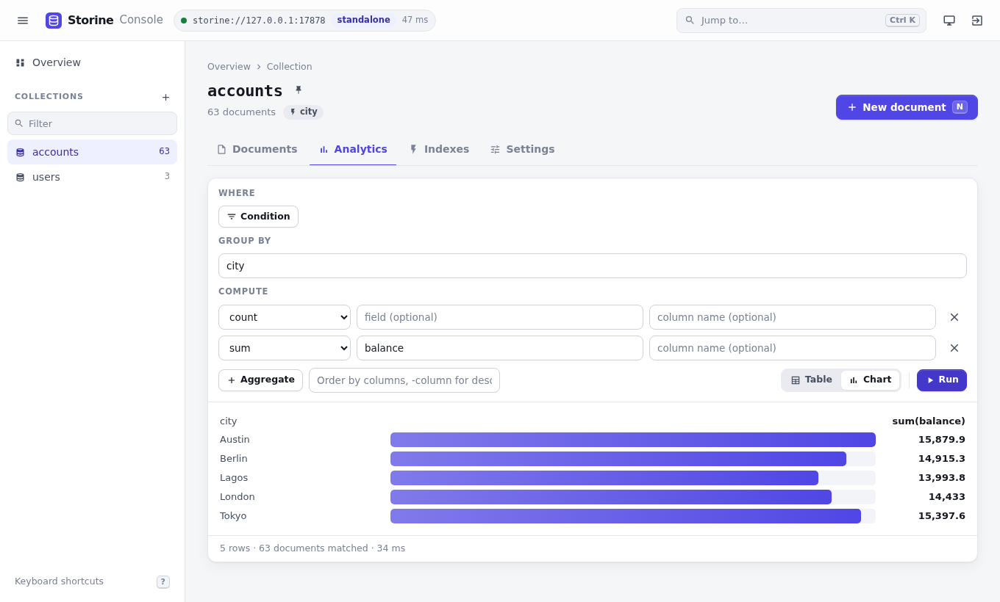
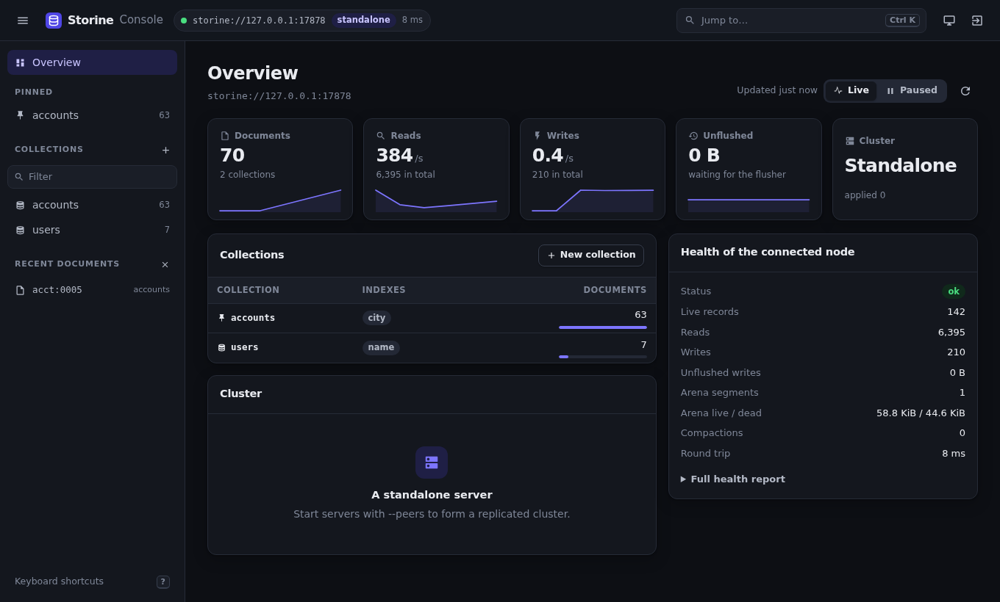

## Starting it

```text
storine-console [--listen 127.0.0.1:7880] [--allow-host HOST:PORT]... [storine://...]
```

```bash
storine-console storine://127.0.0.1:7878
```

It prints a link that holds a key made for this run. Open the link in a browser. Anyone without the key gets nothing, even on the same machine.

| Option | Default | Meaning |
| :--- | :--- | :--- |
| `--listen ADDR` | `127.0.0.1:7880` | Where to serve the console. Anything but loopback serves plain HTTP on the network: prefer an SSH tunnel |
| `--allow-host HOST:PORT` | | Also answer to this `Host` header, when the console is reached through another name. Repeatable |
| `storine://...` | | The server or cluster to connect to. Without it, the console opens on its connect page |
| `-h`, `--help` | | Print the options |

| Environment variable | Meaning |
| :--- | :--- |
| `STORAGE_TOKEN` | Token to authenticate to Storine with |
| `STORAGE_TLS_CA` | PEM file of certificates to trust. Turns TLS on |
| `STORAGE_TLS_SERVER_NAME` | The name the server's certificate must carry |
| `STORINE_CONSOLE_KEY` | Use this key instead of a random one: at least 16 letters, digits, `-` or `_`. Handy for a bookmark |

To reach a console on a server from your laptop, keep it on loopback there and tunnel to it:

```bash
ssh -L 7880:127.0.0.1:7880 db-host
# then open the link it printed, on your laptop
```

## What it shows

| View | What you can do |
| :--- | :--- |
| **Overview** | The node's role, term, commit and applied indexes, the cluster's members, the node's health report, and every collection with its document count. Live: refreshed every 5 seconds while shown (you can pause it) and every 30 seconds elsewhere, with sparklines of reads and writes a second, documents, and unflushed bytes over the last 60 samples, and the round trip to the server |
| **Documents** | Conditions on any field, a key prefix, sorting by clicking a column, page size, keyset or offset pages, a column chooser, compact rows, and downloading the page as JSON |
| **Document editor** | Create, replace and delete, in a tree view or as JSON. Saving and deleting check the version you opened, so you never overwrite someone else's change. A delete can be undone from its notice for 7 seconds |
| **Analytics** | Group by fields, choose aggregates and their order, and see the result as a table and a chart |
| **Indexes** | Secondary and vector indexes with their state, created and dropped from here |
| **Settings** | The collection's metadata, and dropping the collection after typing its name |

| Analytics | Overview in dark mode |
| :---: | :---: |
|  |  |

## Typed values in the editor

JSON has no words for some Storine types, so the editor writes them as one-key objects:

| Type | In the editor |
| :--- | :--- |
| Decimal | `{"$decimal": "9.99"}` |
| Timestamp | `{"$time": "2026-11-13T08:00:00Z"}` |
| Bytes | `{"$bytes": "<base64>"}` |
| UUID | `{"$uuid": "6f1c2a7e-..."}` |
| Id | `{"$id": "<48 hex digits>"}` |
| Integers beyond 2^53 | `{"$int": "123456789012345678901"}` |
| Float specials | `{"$float": "NaN"}`, `"Infinity"`, `"-Infinity"` |

A bare `1` is an integer and `1.0` a float.

## What it remembers

The console keeps your work in the browser, per server, and never stores documents or tokens there:

- each collection's conditions, sort, page size, columns and analytics;
- the last 15 queries run on a collection, and named saved queries;
- pinned collections, and the last 12 documents you opened;
- theme, row density, the sidebar, and tree or JSON view.

Unsaved edits to a document are kept for the browser tab and restored when you open the document again, together with the version they were made on, so saving still checks it. The open document is part of the address (`#/c/<name>?doc=<key>`), so a reload or a shared link reopens it.

## Keyboard

| Keys | Does |
| :--- | :--- |
| `Ctrl K`, `⌘K` | The command palette: collections, tabs, recent documents, saved queries and actions, or type a key to open it |
| `j`, `k` | Move through results and the open document |
| `Enter` | Open the selected document |
| `[`, `]` | Previous and next page |
| `/` | Add a filter |
| `n` | New document |
| `g` then `o`, `d`, `a`, `i` | Go to overview, documents, analytics, indexes |
| `?` | List the shortcuts |

## Security

- It listens on loopback by default.
- Every API request must carry the key in an `X-Console-Key` header. That also makes browsers ask before sending it from another site, which the console never allows.
- A request whose `Host` header does not name the console is refused, which stops DNS-rebinding attacks.
- The page runs under a strict content security policy with no inline script or style, and is never cached or framed.
- It serves at most 64 connections at once.

The console has no web code inside the server: it is a separate program that talks to Storine through the Rust client, with the same roles as any client. Give it a `read` token to browse without being able to change anything.

The page is three files, `index.html`, `app.js` and `app.css`, compiled into the binary. It uses system fonts and inline SVG, and a unit test fails if any of them refers to another origin.
